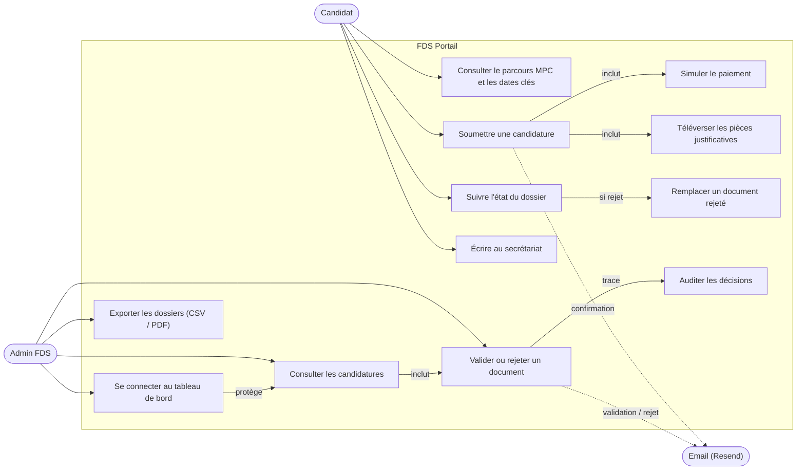
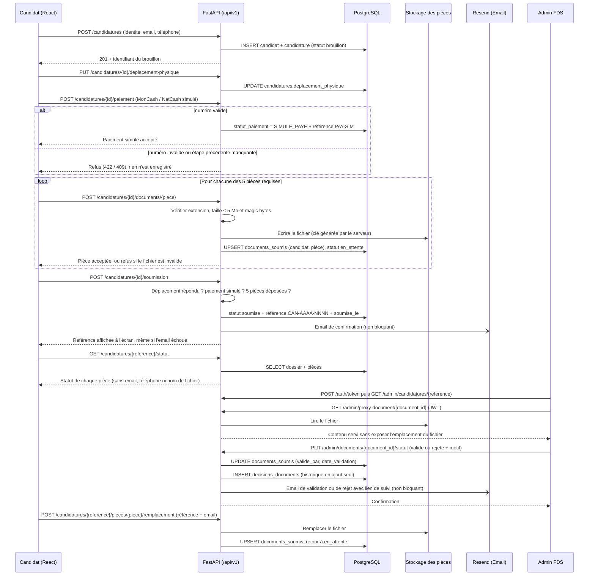
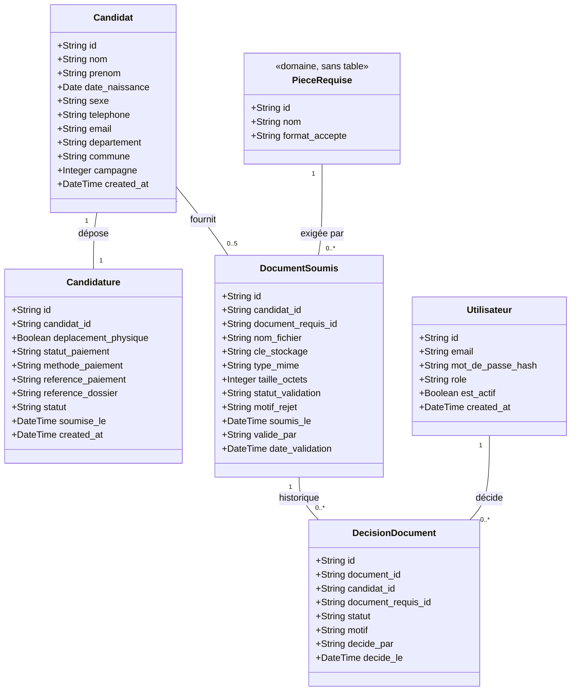
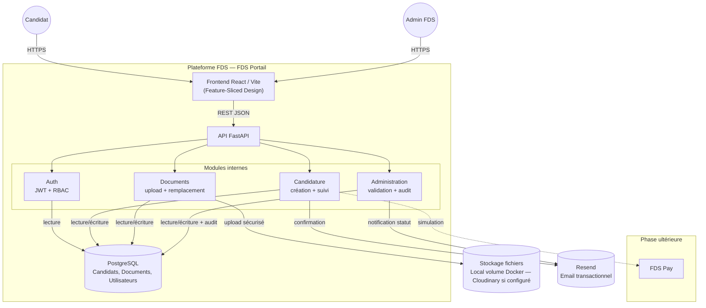

# Cahier des Charges — FDS Portail (Remanié)
**GL-EN3-2026 · Équipe Bravetech · M2 FDS Portail**

> Ce document est le Livrable 1 du Projet 2. Il reprend et corrige le cahier des charges du Projet 1 selon les retours reçus. Le détail technique (ADRs, stack justifiée, NFR chiffrées, plan de tests) se trouve dans `project-docs/` — ce document n'en est que la synthèse orientée décision.

---

## §1. Le problème

La Faculté des Sciences (FDS) de l'UEH forme l'élite de l'ingénierie en Haïti. Pourtant, sa relation avec les futurs étudiants souffre de trois dysfonctionnements structurels :

- **Déficit d'information :** Les informations sur les cursus, les prérequis et les dates circulent via des canaux informels (WhatsApp, bouche-à-oreille). Il n'existe pas de source officielle accessible sur mobile.
- **Friction géographique :** Un candidat hors de Port-au-Prince doit obligatoirement se déplacer physiquement pour obtenir une information fiable ou déposer un dossier papier.
- **Opérations manuelles :** Le secrétariat gère des piles de dossiers physiques, sans traçabilité ni possibilité de suivi pour le candidat.

---

## §2. La solution proposée

**FDS Portail (Module 2)** est la vitrine publique officielle de la FDS et la plateforme dématérialisée d'inscription. Elle transforme le chaos informationnel en certitude pour le candidat : s'informer, postuler et suivre son dossier intégralement en ligne depuis un smartphone.

---

## §3. Le persona

**Louismy, 17 ans**, élève en Terminale aux Cayes, à environ 200 km de Port-au-Prince. Il possède un smartphone Android avec une connexion 3G intermittente. Se rendre à Delmas 33 lui coûte une journée de route, des frais de transport et une prise de risque sur des axes peu sûrs. Il souhaite s'inscrire à la FDS (admission au MPC, puis choix d'une branche d'ingénierie), mais ne trouve pas facilement d'informations officielles sur les dates, les modalités d'admission et les prérequis.

---

## §4. L'interview utilisateur

Afin de valider la réalité du terrain, une interview a été menée auprès d'un profil correspondant au persona principal. La consigne d'ouverture était :

*« Racontez-moi ce que vous avez fait pour trouver des informations sur la FDS et comprendre comment postuler, depuis le moment où vous avez décidé de vous y intéresser jusqu'au moment où vous avez soumis votre candidature ou abandonné l'idée. »*

**Q1 — Première recherche :** J'ai cherché sur Google. J'ai trouvé un ancien site web avec les cursus, mais les informations semblaient peu à jour et difficile à naviguer. Le formulaire de contact ne fonctionnait pas.

**Q2 — Alternative :** J'ai trouvé un numéro de téléphone et j'ai appelé, sans réponse. J'ai compris qu'il fallait me rendre sur place.

**Q3 — Déplacement :** Chaque déplacement comporte une appréhension à cause du contexte sécuritaire. Je me demandais comment une école d'ingénieurs de renom pouvait ne pas avoir de site moderne pour s'inscrire en ligne.

**Q4 — Sur place :** Le secrétariat m'a remis une brochure photocopiée avec des corrections à la main. On m'a demandé de revenir dans deux semaines pour le calendrier.

**Q5 — Candidature :** Je suis revenu quelques semaines plus tard pour remplir un formulaire papier. On m'a confirmé mon admissibilité et communiqué la date du concours.

**Q6 — Suggestions :** Il faudrait un site à jour avec les cursus, les prérequis, les dates et les frais. Et la possibilité de postuler en ligne.

**Verbatims clés :**
> *« J'ai trouvé un ancien site web avec les cursus, mais les informations semblaient peu à jour et le site était difficile à naviguer. »*

> *« Je me demandais comment une école d'ingénieurs de renom pouvait ne pas disposer d'un site moderne avec la possibilité de faire des inscriptions en ligne. »*

---

## §5. Customer Journey Map

| Étape | Actions | Ressenti | Pain Points | Opportunités |
|---|---|---|---|---|
| **1. Recherche** | Cherche « FDS Haïti » sur Google | Perte de temps, doute | Ancien site non mis à jour | Portail officiel centralisé + SEO |
| **2. Contact** | Cherche un numéro, tente d'appeler | Frustration | Aucun canal fiable | Contacts clairs + FAQ |
| **3. Déplacement** 🚨 | Se rend à Delmas 33 | Stress, appréhension | Coûteux, risques sécuritaires | **Candidature 100 % en ligne** |
| **4. Sur place** | Interroge étudiants puis secrétariat | Soulagement temporaire | Brochure papier peu professionnelle | Fiches cursus digitalisées |
| **5. Attente** | Doit revenir pour le calendrier | Agacement | Pas de calendrier en ligne | Dates clés publiées |
| **6. Candidature** 🎯 | Remplit un formulaire papier | Résignation | Procédure lente et manuelle | Formulaire d'upload Mobile-First |
| **7. Confirmation** | Reçoit un numéro d'inscription | Soulagement | Aucun suivi numérique | Référence + suivi en ligne |

**Principal problème identifié :** forte dépendance au déplacement physique, causée par un déficit d'information numérique fiable et centralisée — créant une inégalité d'accès pour les candidats hors de Port-au-Prince.

---

## §6. Job to Be Done

Le Job to Be Done résume la motivation profonde du persona :

> **« Quand je** dois m'inscrire à l'université depuis ma province sans information claire, **je veux** pouvoir m'informer, soumettre mon dossier et payer virtuellement les frais entièrement en ligne **afin de** sécuriser ma candidature à la FDS sans perdre de temps ni risquer ma sécurité dans un déplacement physique. »

---

## §7. L'hypothèse testable

Le JTBD ci-dessus fonde l'hypothèse suivante :

| Élément | Formulation |
|---|---|
| **Nous croyons que** | les lycéens, notamment ceux vivant hors de Port-au-Prince, rencontrent des difficultés importantes pour obtenir des informations fiables et soumettre leur candidature à la FDS. |
| **Ils ont besoin de** | consulter des informations officielles et postuler entièrement en ligne depuis un smartphone. |
| **Afin de** | réduire les déplacements physiques, économiser du temps et améliorer l'accès aux études d'ingénierie. |
| **Nous saurons que cela fonctionne si** | au moins **20 candidatures** sont soumises en ligne durant les deux premières semaines et que **70 % des candidats** complètent le processus sans déplacement physique. |

**Plan de mesure :**

| Indicateur | Méthode | Seuil |
|---|---|---|
| Candidatures soumises | Comptage des `candidatures` au statut `soumise` (référence `CAN-AAAA-NNNN` attribuée à la soumission) | ≥ 20 en 14 jours |
| Taux sans déplacement | Question obligatoire `candidatures.deplacement_physique` | ≥ 70 % répondent « Non » |
| Taux d'abandon | `candidatures` restées au statut `brouillon` / candidatures commencées | ≤ 30 % |
| Temps de soumission | `candidatures.soumise_le − candidatures.created_at` (de l'étape 1 à la soumission) | ≤ 20 min sur mobile |
| Correction en ligne | Pièces rejetées (historique `decisions_documents`) redéposées ensuite (`documents_soumis` repassé à `en_attente` ou validé) | ≥ 80 % des rejets corrigés |

---

## §8. Priorisation MoSCoW

### 🟢 Must Have — Requis pour le MVP

- Pages de présentation du parcours (Premier cycle MPC puis branches d'ingénierie) et dates clés.
- Formulaire de candidature en ligne avec upload de pièces justificatives (PDF/JPG).
- Génération d'un numéro de référence de dossier (ex : `CAN-2026-X`).
- Suivi du dossier en ligne par le candidat via sa référence.
- Interface sécurisée pour l'administration (changer le statut d'un document).
- Notifications automatiques par email au candidat : confirmation de réception, validation et rejet d'un document (avec lien pour remplacer).
- Possibilité de remplacer un document rejeté depuis la page de suivi.
- Simulation du paiement des frais (MonCash / NatCash) — aucune transaction réelle.
- Question obligatoire `deplacement_physique` pour mesurer l'hypothèse §7.

### 🟡 Should Have — Important

- Notifications push (SMS) en complément de l'email.

### 🔵 Could Have — Souhaitable

- Export CSV/PDF filtré de la liste des dossiers validés, pour les commissions d'admission hors ligne.
- Mode sombre pour l'interface administrative et le formulaire candidat.

### 🔴 Won't Have — Hors périmètre Phase 1

- Transactions monétaires réelles (déléguées au module FDS Pay).
- Plateforme de cours (déléguée à FDS Akademi).

---

## §9. Walking Skeleton

> Louismy ouvre le portail FDS sur son téléphone Android. Il consulte la page du Premier cycle MPC. Il clique sur « Postuler », renseigne ses informations personnelles et confirme son admission au MPC, puis répond à la question obligatoire sur le déplacement physique. Il accède à l'interface de simulation de paiement (MonCash/NatCash) : une fois le paiement virtuel validé, il uploade ses pièces justificatives. Le système lui affiche immédiatement sa référence `CAN-2026-0089` et lui envoie un email de confirmation contenant cette référence et un lien vers la page de suivi.
>
> Plus tard, Louismy retrouve son dossier via la page `/suivi`. Il voit une barre de progression indiquant que son dossier est « En attente de validation ». L'administration valide ou rejette un document — Louismy reçoit immédiatement un email de statut. Si un document est rejeté, la page affiche « Correction requise » et il peut remplacer le document directement depuis cette page.

---

## §10. Use Cases — Diagramme

Ce diagramme présente les interactions entre les deux acteurs : le **candidat** et l'**administrateur FDS**. Le candidat n'a pas besoin de compte pour postuler ; il utilise sa référence pour suivre son dossier. L'administrateur doit obligatoirement s'authentifier avant d'accéder aux dossiers. Le mode sombre (Could Have) et le sélecteur de langue FR / Kreyòl sont des réglages d'interface disponibles sur tous les écrans : ils ne forment pas des cas d'utilisation à part. Les notifications SMS (Should Have) ne figurent pas au diagramme : elles ne sont pas livrées (voir le §2 du rapport).



> **Les user stories détaillées** de chaque cas d'utilisation vivent dans `project-docs/execution/` — voir [EPIC_EXECUTION.md](project-docs/execution/EPIC_EXECUTION.md) pour la liste complète (US-001 à US-027, réparties en cinq Epics).

---

## §11. Diagrammes de séquence

Ce diagramme précise la collaboration entre le frontend React, l'API FastAPI, PostgreSQL, le stockage des pièces (volume de la VM) et Resend. La candidature se construit en brouillon, étape par étape : la référence `CAN-AAAA-NNNN` n'est attribuée qu'à la soumission. Les emails sont déclenchés par des événements métier et ne sont jamais la source de vérité du dossier.



**Note clé :** si l'envoi d'email échoue, le dossier et ses statuts restent enregistrés en base de données : l'email est une notification, pas la source de vérité.

---

## §12. Modèle de données

### Principes

Le modèle respecte trois principes :

1. **Langage ubiquitaire (DDD) :** les noms des entités (`Candidat`, `Candidature`, `DocumentSoumis`) reprennent le vocabulaire du secrétariat FDS.
2. **Normalisation 3NF :** on sépare *qui est le candidat* (`candidats`), *son dossier pour une campagne* (`candidatures`), *ce qui est exigé* (les pièces requises, définies dans le domaine) et *ce qui est fourni* (`documents_soumis`).
3. **Traçabilité :** chaque décision du personnel est conservée dans `decisions_documents`, une table en ajout seul, même après le remplacement d'une pièce.

> **Rejugé pendant le Projet 2.** Le modèle du Projet 1 mettait la référence, le paiement et le déplacement dans `candidats`. À l'implémentation (US-005, 2026-11-01), ils sont passés dans `candidatures` : une personne peut re-candidater d'une campagne à l'autre, alors que paiement et référence appartiennent à un dossier. L'admission unique au MPC (ADR-008, 2026-10-31) a supprimé tout champ cursus. La table `decisions_documents` (US-013) a été ajoutée pour l'audit. Le schéma est versionné par des migrations Alembic (US-023).

> **Pièces requises :** l'admission est unique (Premier cycle MPC) : la liste des pièces est la même pour tous (acte de naissance, Bac II, relevé de notes du Bac, deux photos d'identité, CIN). Elle est définie dans le domaine (`backend/entities/pieces_admission.py`), pas dans une table : `documents_soumis.document_requis_id` y fait référence.

### 12.1 Diagramme de classes



### 12.2 Contraintes métier

- Chaque dossier soumis possède une référence unique `CAN-AAAA-NNNN`, attribuée **à la soumission** (un brouillon n'en a pas).
- Un candidat peut re-candidater d'une année à l'autre : l'unicité est `(email, campagne)`, pas `email` seul. Une seule candidature par candidat et par campagne. La candidature ne porte aucun cursus : l'admission est unique (MPC).
- Formats autorisés : **PDF, JPG, PNG** (photos d'identité : JPG ou PNG). Taille maximale : **5 Mo**.
- Le backend vérifie le type réel du fichier (magic bytes), l'extension et la taille **avant** tout stockage. Le nom du fichier stocké est généré par le serveur, jamais repris du candidat.
- La soumission exige : la question `deplacement_physique` répondue, le paiement simulé au statut `SIMULE_PAYE`, et les 5 pièces déposées. Sinon, la liste de ce qui manque est renvoyée.
- `(candidat_id, document_requis_id)` est unique : remplacer une pièce rejetée est un upsert, son statut repasse à `en_attente`.
- Toute décision du personnel est auditée : `valide_par` et `date_validation` sur la pièce, plus une ligne dans `decisions_documents`, jamais modifiée ni supprimée.
- `deplacement_physique` est obligatoire à la soumission ; les dossiers antérieurs peuvent avoir `NULL`.
- Les identifiants sont des UUID générés par l'application et stockés en `VARCHAR(36)`. Tous les horodatages sont en UTC.

### 12.3 Schéma SQL (tables principales, PostgreSQL)

```sql
CREATE TABLE candidats (
    id VARCHAR(36) PRIMARY KEY,
    nom VARCHAR(100) NOT NULL,
    prenom VARCHAR(100) NOT NULL,
    date_naissance DATE NOT NULL,
    sexe VARCHAR(1) NOT NULL,
    telephone VARCHAR(20) NOT NULL,
    email VARCHAR(255) NOT NULL,
    departement VARCHAR(50) NOT NULL,
    commune VARCHAR(100) NOT NULL,
    campagne SMALLINT NOT NULL,
    created_at TIMESTAMPTZ NOT NULL,
    CONSTRAINT uq_candidats_email_campagne UNIQUE (email, campagne)
);

CREATE TABLE candidatures (
    id VARCHAR(36) PRIMARY KEY,
    candidat_id VARCHAR(36) NOT NULL UNIQUE REFERENCES candidats(id) ON DELETE CASCADE,
    deplacement_physique BOOLEAN,
    statut_paiement VARCHAR(50) NOT NULL,           -- en_attente | SIMULE_PAYE
    methode_paiement VARCHAR(20),                   -- MONCASH | NATCASH
    reference_paiement VARCHAR(30) UNIQUE,          -- PAY-SIM-AAAA-NNNN
    numero_paiement VARCHAR(20),
    reference_dossier VARCHAR(20) UNIQUE,           -- CAN-AAAA-NNNN, à la soumission
    statut VARCHAR(20) NOT NULL,                    -- brouillon | soumise
    soumise_le TIMESTAMPTZ,
    created_at TIMESTAMPTZ NOT NULL
);

CREATE TABLE documents_soumis (
    id VARCHAR(36) PRIMARY KEY,
    candidat_id VARCHAR(36) NOT NULL REFERENCES candidats(id) ON DELETE CASCADE,
    document_requis_id VARCHAR(100) NOT NULL,       -- pièce définie dans le domaine
    nom_fichier VARCHAR(255) NOT NULL,
    cle_stockage VARCHAR(500) NOT NULL,
    type_mime VARCHAR(50) NOT NULL,
    taille_octets INTEGER NOT NULL,
    statut_validation VARCHAR(20) NOT NULL,         -- en_attente | valide | rejete
    motif_rejet TEXT,
    soumis_le TIMESTAMPTZ NOT NULL,
    valide_par VARCHAR(36),
    date_validation TIMESTAMPTZ,
    CONSTRAINT uq_documents_candidat_piece UNIQUE (candidat_id, document_requis_id)
);

CREATE TABLE utilisateurs (
    id VARCHAR(36) PRIMARY KEY,
    email VARCHAR(255) NOT NULL UNIQUE,
    mot_de_passe_hash VARCHAR(255) NOT NULL,        -- bcrypt
    role VARCHAR(20) NOT NULL,                      -- admin | agent
    est_actif BOOLEAN NOT NULL,
    created_at TIMESTAMPTZ NOT NULL
);

CREATE TABLE decisions_documents (                  -- en ajout seul
    id VARCHAR(36) PRIMARY KEY,
    document_id VARCHAR(36) NOT NULL,
    candidat_id VARCHAR(36) NOT NULL REFERENCES candidats(id) ON DELETE CASCADE,
    document_requis_id VARCHAR(100) NOT NULL,
    statut VARCHAR(20) NOT NULL,                    -- valide | rejete
    motif TEXT,
    decide_par VARCHAR(36) NOT NULL REFERENCES utilisateurs(id),
    decide_le TIMESTAMPTZ NOT NULL
);
```

Source exacte : la migration `backend/dal/migrations/versions/0001_schema_initial.py`.

---

## §13. Architecture technique

### Vue d'ensemble

FDS Portail adopte un **Monolithe Modulaire** dont le code interne est organisé en **4 couches (Clean Architecture)** avec une règle absolue : les dépendances ne pointent que vers l'intérieur.

| Couche | Contenu |
|---|---|
| **Domain** (`entities/`) | Entités métier pures — n'importe rien d'externe |
| **Application** (`bll/` + `ports/`) | Use cases et interfaces abstraites |
| **Infrastructure** (`dal/`) | Adaptateurs concrets (SQLAlchemy, stockage, email) |
| **Présentation** (`api/`) | Routers FastAPI, DTOs Pydantic — aucune logique métier |

### Diagramme de composants



**Déploiement — sur les serveurs de la Faculté des Sciences (bonus +10 pts) :**

Le portail tourne sur une machine virtuelle Linux du Proxmox de la FDS, en Docker Compose, et il est public à l'adresse **https://dorfilus.ueh.edu.ht**.

| Composant | Où | Note |
|---|---|---|
| Frontend | Conteneur Nginx sur la VM FDS | Sert l'application React et relaie `/api/` vers l'API |
| API | Conteneur FastAPI sur la VM FDS | Migrations Alembic appliquées au démarrage |
| Base de données | Conteneur PostgreSQL 15 sur la VM FDS | Volume persistant ; copie avant chaque déploiement |
| Pièces justificatives | Volume Docker sur la VM FDS | Jamais exposées directement : servies par l'API au personnel authentifié |
| HTTPS | Apache de l'UEH (certificat `*.ueh.edu.ht`) | Relaie vers la VM |
| Livraison | GitHub Actions → GHCR → SSH | Chaque fusion sur `master` avec la CI verte est mise en ligne ; retour automatique à la version précédente si le contrôle de santé échoue |

> Le détail des décisions d'architecture (ADR-001 à ADR-009, dont ADR-006 pour l'hébergement sur Proxmox et ADR-009 pour le déploiement continu), la règle de dépendance et les tests d'architecture automatisés sont documentés dans [`project-docs/SOLUTION_DESIGN.md`](project-docs/SOLUTION_DESIGN.md).

---

## §14. Choix technologiques

| Couche | Technologie | Justification |
|---|---|---|
| Frontend | React 19 / Vite / TypeScript | SPA mobile d'abord, Feature-Sliced Design, typage fort |
| Backend | FastAPI / Python 3.11 | OpenAPI généré, validation Pydantic, routes simples à tester |
| Base de données | PostgreSQL 15 | ACID, intégrité référentielle, contraintes d'unicité métier |
| ORM et schéma | SQLAlchemy 2.x + Alembic | Requêtes paramétrées (anti-injection) ; migrations versionnées, sans perte de données |
| Auth | JWT HS256 + bcrypt | Session du personnel sans état serveur, mots de passe hachés, rôles admin / agent |
| Stockage fichiers | Volume local Docker (défaut) / Cloudinary (adaptateur possible) | Autonomie sur la VM de la FDS (ADR-007) |
| Email | Resend (API REST) ; envoi désactivable, console en développement | Non bloquant : une panne d'email n'annule jamais une candidature |
| Hébergement | Docker Compose sur la VM Proxmox de la FDS | Hébergement à la Faculté (ADR-006), bonus +10 pts |
| Intégration et livraison | GitHub Actions (tests backend + frontend, GitGuardian) → images GHCR → déploiement SSH | Rien n'arrive en production sans CI verte ; retour arrière automatique (ADR-009) |

> La justification complète de chaque choix (compromis, sécurité, performance en 3G, accessibilité) est documentée dans [`project-docs/SOLUTION_DESIGN.md`](project-docs/SOLUTION_DESIGN.md) et [`project-docs/NFR.md`](project-docs/NFR.md).

---

*GL-EN3-2026 · Équipe Bravetech — VAILLANT Valcin · DORFILUS Skin-Paolatchi · GUERRIER Joas · LOUIS Widmaken*
