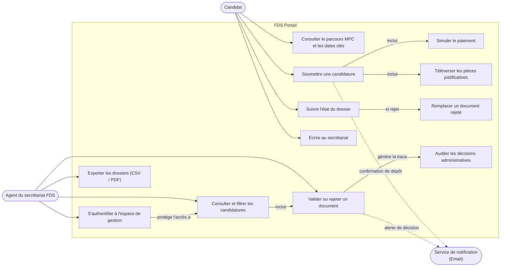
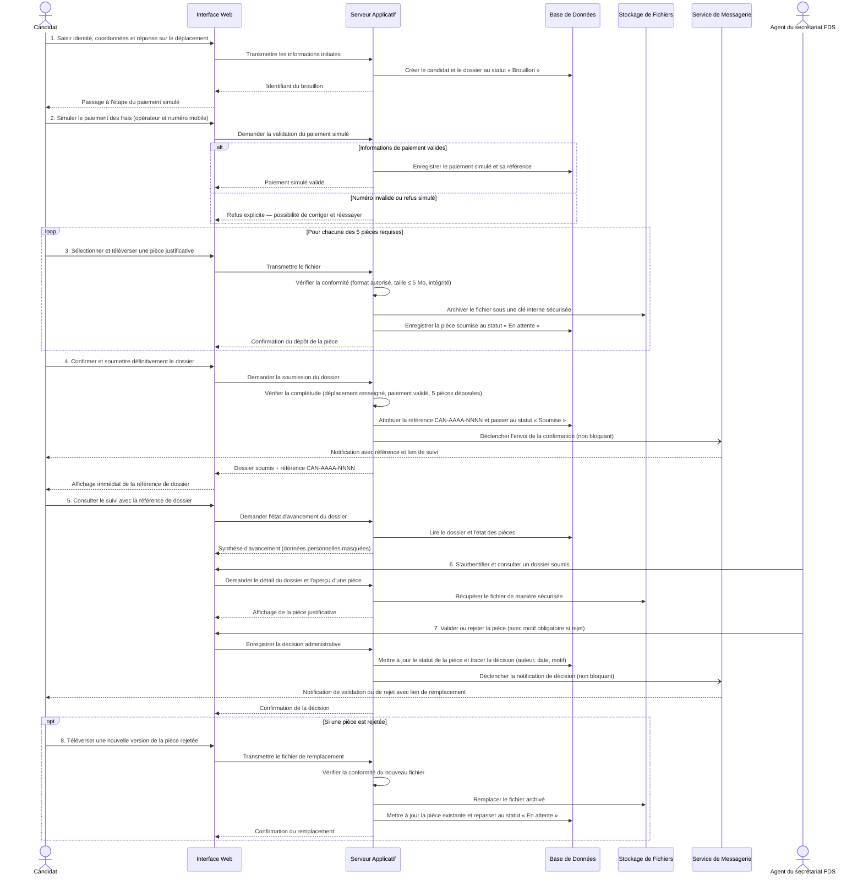
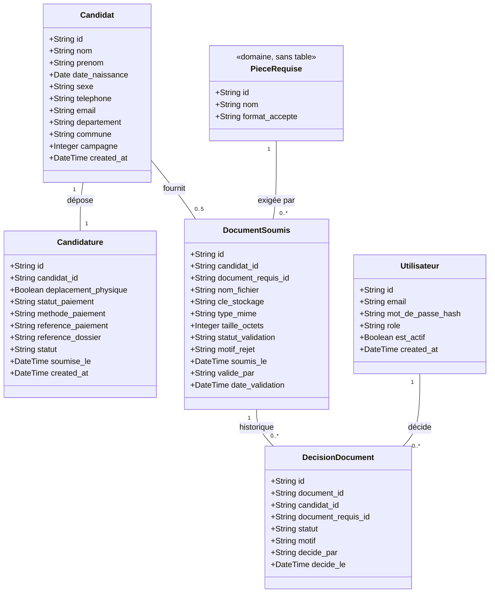
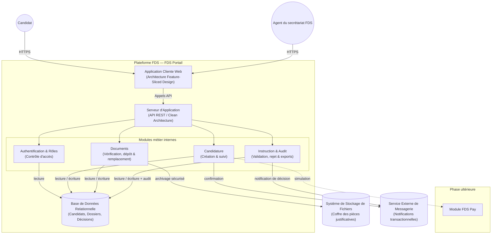

# Cahier des Charges — FDS Portail (Remanié)
**GL-EN3-2026 · Équipe Bravetech · M2 FDS Portail**

> Ce document constitue le **Livrable 1** du Projet 2 (Génie Logiciel, FDS-UEH). Il formalise le contrat fonctionnel et méthodologique du module **FDS Portail**, en reprenant et corrigeant le cahier des charges initial selon les retours d'évaluation reçus. Le détail technique approfondi (décisions d'architecture ADRs, métriques de qualité NFR chiffrées, spécifications de couches) est déporté dans le dossier `project-docs/`.

---

## Introduction & Méthode de conception

### Objectif du document
L'objectif de ce cahier des charges est de définir avec rigueur le problème d'accès aux admissions de la Faculté des Sciences (FDS-UEH), d'exposer la solution numérique retenue et de délimiter avec précision le périmètre fonctionnel du produit à développer. Il sert d'engagement contractuel entre l'équipe Bravetech et l'institution, en garantissant que chaque fonctionnalité découle directement d'un besoin réel observé sur le terrain.

### Démarche suivie à travers les quatorze sections
La conception du projet s'articule autour d'une chaîne de valeur continue en quatre temps :
1. **Compréhension du problème et ancrage terrain (§1 à §5) :** Identification des dysfonctionnements structurels, modélisation de la solution, définition du persona cible (Louismy), validation par interview qualitative et cartographie détaillée de l'expérience utilisateur (Customer Journey Map).
2. **De l'intention utilisateur à l'engagement du MVP (§6 à §9) :** Formulation du *Job to Be Done* fondateur, formalisation de l'hypothèse testable mesurable, priorisation MoSCoW délimitant le produit minimum viable, et description du parcours de référence (*Walking Skeleton*).
3. **Modélisation fonctionnelle et conceptuelle (§10 à §12) :** Cartographie globale des cas d'utilisation, diagramme dynamique de séquence des flux, modèle de données conceptuel adossé au langage ubiquitaire (DDD) et contraintes d'intégrité.
4. **Synthèse architecturale et technologique (§13 et §14) :** Décomposition modulaire en composants (Clean Architecture) et justification résumée de la pile technologique adoptée.

---

## §1. Le problème

La Faculté des Sciences (FDS) de l'UEH forme l'élite de l'ingénierie en Haïti. Pourtant, sa relation avec les futurs étudiants souffre de trois dysfonctionnements structurels :

- **Déficit d'information :** Les informations sur les cursus, les prérequis et les dates circulent via des canaux informels (WhatsApp, bouche-à-oreille). Il n'existe pas de source officielle accessible sur mobile.
- **Friction géographique :** Un candidat hors de Port-au-Prince doit obligatoirement se déplacer physiquement pour obtenir une information fiable ou déposer un dossier papier.
- **Opérations manuelles :** Le secrétariat gère des piles de dossiers physiques, sans traçabilité ni possibilité de suivi pour le candidat.

---

## §2. La solution proposée

**FDS Portail (Module 2)** est la vitrine publique officielle de la FDS et la plateforme dématérialisée d'inscription. Elle transforme le chaos informationnel en certitude pour le candidat : s'informer, postuler et suivre son dossier intégralement en ligne depuis un smartphone.

---

## §3. Le persona

**Louismy, 17 ans**, élève en Terminale aux Cayes, à environ 200 km de Port-au-Prince. Il possède un smartphone Android avec une connexion 3G intermittente. Se rendre à Delmas 33 lui coûte une journée de route, des frais de transport et une prise de risque sur des axes peu sûrs. Il souhaite s'inscrire à la FDS (admission au MPC, puis choix d'une branche d'ingénierie), mais ne trouve pas facilement d'informations officielles sur les dates, les modalités d'admission et les prérequis.

---

## §4. L'interview utilisateur

Afin de valider la réalité du terrain, une interview a été menée auprès d'un profil correspondant au persona principal. La consigne d'ouverture était :

*« Racontez-moi ce que vous avez fait pour trouver des informations sur la FDS et comprendre comment postuler, depuis le moment où vous avez décidé de vous y intéresser jusqu'au moment où vous avez soumis votre candidature ou abandonné l'idée. »*

**Q1 — Première recherche :** J'ai cherché sur Google. J'ai trouvé un ancien site web avec les cursus, mais les informations semblaient peu à jour et difficile à naviguer. Le formulaire de contact ne fonctionnait pas.

**Q2 — Alternative :** J'ai trouvé un numéro de téléphone et j'ai appelé, sans réponse. J'ai compris qu'il fallait me rendre sur place.

**Q3 — Déplacement :** Chaque déplacement comporte une appréhension à cause du contexte sécuritaire. Je me demandais comment une école d'ingénieurs de renom pouvait ne pas avoir de site moderne pour s'inscrire en ligne.

**Q4 — Sur place :** Le secrétariat m'a remis une brochure photocopiée avec des corrections à la main. On m'a demandé de revenir dans deux semaines pour le calendrier.

**Q5 — Candidature :** Je suis revenu quelques semaines plus tard pour remplir un formulaire papier. On m'a confirmé mon admissibilité et communiqué la date du concours.

**Q6 — Suggestions :** Il faudrait un site à jour avec les cursus, les prérequis, les dates et les frais. Et la possibilité de postuler en ligne.

**Verbatims clés :**
> *« J'ai trouvé un ancien site web avec les cursus, mais les informations semblaient peu à jour et le site était difficile à naviguer. »*

> *« Je me demandais comment une école d'ingénieurs de renom pouvait ne pas disposer d'un site moderne avec la possibilité de faire des inscriptions en ligne. »*

---

## §5. Customer Journey Map (Cartographie du parcours utilisateur)

### 5.1 Intérêt méthodologique & Objectif de la cartographie
L'interview utilisateur qualitative menée au §4 a révélé des constats vécus sur le terrain. L'objectif de la **Customer Journey Map** est de formaliser et d'analyser chronologiquement cette expérience afin d'en objectiver les ruptures. 

En confrontant les actions successives du candidat à son ressenti émotionnel et aux blocages rencontrés (*Pain Points*), cette analyse permet de cibler les opportunités numériques de plus forte valeur ajoutée. C'est précisément l'identification du goulot d'étranglement critique — l'obligation d'un déplacement physique périlleux pour une simple démarche d'inscription — qui légitime et fonde le *Job to Be Done* (§6) et l'hypothèse testable (§7).

### 5.2 Vocabulaire préalable du parcours
Afin d'assurer une lecture univoque de la cartographie ci-dessous, les dimensions d'analyse sont définies ainsi :
- **Étape :** Phase chronologique distincte franchie par le candidat dans sa démarche pour intégrer la Faculté.
- **Actions :** Démarches concrètes entreprises par le candidat (recherches en ligne, appels, trajets physiques, dépôts de dossiers).
- **Ressenti :** État d'esprit et charge émotionnelle éprouvés par le candidat (doute, frustration, anxiété liée au déplacement, soulagement).
- **Pain Points (Points de friction) :** Obstacles majeurs, lourdeurs administratives, coûts financiers ou risques sécuritaires subis par le candidat.
- **Opportunités :** Réponses fonctionnelles et ergonomiques apportées par la plateforme numérique pour éliminer chaque point de friction.
- **Friction géographique :** Contrainte spatiale imposant à un candidat provincial de franchir des axes routiers dangereux pour accomplir un acte administratif simple.

*(Note de mise en page : dans le livrable imprimé ou PDF final, la matrice ci-après est présentée sur une page dédiée au format paysage pour garantir un confort optimal de lecture.)*

### 5.3 Matrice du parcours utilisateur

| Étape | Actions | Ressenti | Pain Points | Opportunités |
|---|---|---|---|---|
| **1. Recherche** | Cherche « FDS Haïti » sur Google | Perte de temps, doute | Ancien site non mis à jour | Portail officiel centralisé + SEO |
| **2. Contact** | Cherche un numéro, tente d'appeler | Frustration | Aucun canal fiable | Contacts clairs + FAQ |
| **3. Déplacement** 🚨 | Se rend à Delmas 33 | Stress, appréhension | Coûteux, risques sécuritaires | **Candidature 100 % en ligne** |
| **4. Sur place** | Interroge étudiants puis secrétariat | Soulagement temporaire | Brochure papier peu professionnelle | Fiches cursus digitalisées |
| **5. Attente** | Doit revenir pour le calendrier | Agacement | Pas de calendrier en ligne | Dates clés publiées |
| **6. Candidature** 🎯 | Remplit un formulaire papier | Résignation | Procédure lente et manuelle | Formulaire d'upload Mobile-First |
| **7. Confirmation** | Reçoit un numéro d'inscription | Soulagement | Aucun suivi numérique | Référence + suivi en ligne |

**Principal problème identifié :** forte dépendance au déplacement physique, causée par un déficit d'information numérique fiable et centralisée — créant une inégalité d'accès pour les candidats hors de Port-au-Prince.

---

## §6. Job to Be Done

Le Job to Be Done résume la motivation profonde du persona :

> **« Quand je** dois m'inscrire à l'université depuis ma province sans information claire, **je veux** pouvoir m'informer, soumettre mon dossier et payer virtuellement les frais entièrement en ligne **afin de** sécuriser ma candidature à la FDS sans perdre de temps ni risquer ma sécurité dans un déplacement physique. »

---

## §7. L'hypothèse testable

Le JTBD ci-dessus fonde l'hypothèse suivante :

| Élément | Formulation |
|---|---|
| **Nous croyons que** | les lycéens, notamment ceux vivant hors de Port-au-Prince, rencontrent des difficultés importantes pour obtenir des informations fiables et soumettre leur candidature à la FDS. |
| **Ils ont besoin de** | consulter des informations officielles et postuler entièrement en ligne depuis un smartphone. |
| **Afin de** | réduire les déplacements physiques, économiser du temps et améliorer l'accès aux études d'ingénierie. |
| **Nous saurons que cela fonctionne si** | au moins **20 candidatures** sont soumises en ligne durant les deux premières semaines et que **70 % des candidats** complètent le processus sans déplacement physique. |

**Plan de mesure :**

| Indicateur | Méthode | Seuil |
|---|---|---|
| Candidatures soumises | Comptage des `candidatures` au statut `soumise` (référence `CAN-AAAA-NNNN` attribuée à la soumission) | ≥ 20 en 14 jours |
| Taux sans déplacement | Question obligatoire `candidatures.deplacement_physique` | ≥ 70 % répondent « Non » |
| Taux d'abandon | `candidatures` restées au statut `brouillon` / candidatures commencées | ≤ 30 % |
| Temps de soumission | `candidatures.soumise_le − candidatures.created_at` (de l'étape 1 à la soumission) | ≤ 20 min sur mobile |
| Correction en ligne | Pièces rejetées (historique `decisions_documents`) redéposées ensuite (`documents_soumis` repassé à `en_attente` ou validé) | ≥ 80 % des rejets corrigés |

---

## §8. Priorisation MoSCoW

### 8.1 Méthode et cadrage du Produit Minimum Viable (MVP)
La méthode **MoSCoW** est un cadre d'arbitrage et de priorisation des exigences logicielles structuré en quatre catégories d'engagement :
- **Must Have (Indispensable) :** Fonctionnalités vitales sans lesquelles le système ne peut pas fonctionner. Elles forment le cœur contractuel de notre **MVP (Minimum Viable Product)**.
- **Should Have (Important) :** Fonctionnalités à forte valeur ajoutée, attendues pour une expérience complète mais non bloquantes pour le premier déploiement opérationnel.
- **Could Have (Souhaitable) :** Fonctionnalités de confort ou d'optimisation, traitées si le temps et les ressources le permettent.
- **Won't Have (Hors périmètre) :** Éléments explicitement exclus du périmètre de cette phase pour préserver la focalisation et la tenue des délais.

**Rôle dans la validation de l'hypothèse :**  
Nous utilisons la priorisation MoSCoW pour délimiter précisément le périmètre du **MVP**. Le *Must Have* rassemble les fonctionnalités strictement indispensables pour tester et prouver l'hypothèse formulée au §7 : permettre à un lycéen (tel que Louismy) de s'informer, postuler, payer virtuellement et suivre son dossier en ligne **sans aucun déplacement physique**, tout en dotant le secrétariat des outils nécessaires pour instruire les pièces.

### 8.2 Découpage des exigences

### 🟢 Must Have — Requis pour le MVP

- Pages de présentation du parcours (Premier cycle MPC puis branches d'ingénierie) et dates clés.
- Formulaire de candidature en ligne avec upload de pièces justificatives (PDF/JPG).
- Génération d'un numéro de référence de dossier (ex : `CAN-2026-X`).
- Suivi du dossier en ligne par le candidat via sa référence.
- Interface sécurisée pour l'administration (changer le statut d'un document).
- Notifications automatiques par email au candidat : confirmation de réception, validation et rejet d'un document (avec lien pour remplacer).
- Possibilité de remplacer un document rejeté depuis la page de suivi.
- Simulation du paiement des frais (MonCash / NatCash) — aucune transaction réelle.
- Question obligatoire `deplacement_physique` pour mesurer l'hypothèse §7.

### 🟡 Should Have — Important

- Notifications push (SMS) en complément de l'email.

### 🔵 Could Have — Souhaitable

- Export CSV/PDF filtré de la liste des dossiers validés, pour les commissions d'admission hors ligne.
- Mode sombre pour l'interface administrative et le formulaire candidat.

### 🔴 Won't Have — Hors périmètre Phase 1

- Transactions monétaires réelles (déléguées au module FDS Pay).
- Plateforme de cours (déléguée à FDS Akademi).

---

## §9. Walking Skeleton

> Louismy ouvre le portail FDS sur son téléphone Android. Il consulte la page du Premier cycle MPC. Il clique sur « Postuler », renseigne ses informations personnelles et confirme son admission au MPC, puis répond à la question obligatoire sur le déplacement physique. Il accède à l'interface de simulation de paiement (MonCash/NatCash) : une fois le paiement virtuel validé, il uploade ses pièces justificatives. Le système lui affiche immédiatement sa référence `CAN-2026-0089` et lui envoie un email de confirmation contenant cette référence et un lien vers la page de suivi.
>
> Plus tard, Louismy retrouve son dossier via la page `/suivi`. Il voit une barre de progression indiquant que son dossier est « En attente de validation ». L'administration valide ou rejette un document — Louismy reçoit immédiatement un email de statut. Si un document est rejeté, la page affiche « Correction requise » et il peut remplacer le document directement depuis cette page.

---

## §10. Use Cases — Diagramme

### 10.1 Définition des acteurs métier
Afin d'éviter toute ambiguïté avec les administrateurs d'infrastructure ou de serveurs informatiques, les acteurs du système sont strictement définis selon leurs rôles métier :
- **Le Candidat :** Usager externe (lycéen ou bachelier). Il consulte l'offre de formation, soumet son dossier d'admission et suit son traitement sans avoir besoin de créer un compte préalable ; il utilise sa référence unique de dossier (`CAN-AAAA-NNNN`).
- **L'Agent du secrétariat FDS :** Membre du personnel administratif de la Faculté des Sciences (et non un administrateur système ou informatique). Il accède à l'espace de gestion par une authentification sécurisée pour instruire les candidatures, valider ou rejeter les pièces déposées et exporter les listes pour les commissions d'admission. Deux niveaux d'habilitation existent : **agent** (instruction des dossiers) et **responsable** (mêmes droits, plus le réglage du calendrier d'admission).
- **Le Service de notification :** Système externe d'acheminement des messages transactionnels (emails de confirmation et alertes de statut).

Le mode sombre (Could Have) et le sélecteur de langue FR / Kreyòl sont des réglages d'ergonomie transverses disponibles sur tous les écrans : ils ne constituent pas des cas d'utilisation distincts.

### 10.2 Diagramme global des cas d'utilisation

> **Les user stories détaillées** de chaque cas d'utilisation vivent dans `project-docs/execution/` — voir [EPIC_EXECUTION.md](project-docs/execution/EPIC_EXECUTION.md) pour la liste complète (US-001 à US-027, réparties en cinq Epics).

---

## §11. Diagrammes de séquence

Ce diagramme présente la collaboration de haut niveau entre les acteurs et les briques logiques du système, indépendamment de tout choix technologique (arrêté au §14).

La candidature se construit progressivement en brouillon : la référence officielle `CAN-AAAA-NNNN` n'est attribuée qu'à la soumission définitive. Les notifications sont déclenchées par des événements métier de manière asynchrone et non bloquante : elles ne constituent jamais la source de vérité du dossier.

**Note clé :** si l'envoi d'une notification échoue, le dossier et ses décisions restent enregistrés en base de données : la messagerie est un canal de notification, jamais la source de vérité.

---

## §12. Modèle de données

### 12.1 Langage Ubiquitaire (Domain-Driven Design)
Le système modélise fidèlement les réalités administratives de la Faculté des Sciences en adoptant le vocabulaire officiel partagé entre le secrétariat, la commission d'admission et les candidats :

| Terme métier | Définition canonique dans le domaine FDS |
|---|---|
| **Candidat** | Personne physique candidate à l'admission. Identifiée par son état civil, son numéro de téléphone normalisé et son adresse email. |
| **Candidature** | Dossier d'admission rattaché à un candidat pour une campagne donnée. Porte le statut du dossier, la réponse d'impact sur le déplacement, la référence officielle et les traces du paiement simulé. |
| **Campagne d'admission** | Année académique du concours (ex. 2026). Règle d'unicité : un candidat ne peut déposer qu'un seul dossier par campagne (`UNIQUE(email, campagne)`). |
| **Premier cycle MPC** | Tronc commun préparatoire unique de 2 ans (Mathématiques, Physique, Chimie) auquel postulent obligatoirement tous les candidats (ADR-008). |
| **Branche** | Spécialité d'ingénierie de 3 ans (Génie Civil, Génie Électromécanique, Génie Électronique, Architecture) choisie à l'issue du MPC, hors du portail. |
| **Pièce requise** | Document obligatoire exigé par la Faculté pour composer le dossier d'admission (liste unique de 5 pièces : acte de naissance, Bac II, relevé de notes, 2 photos, CIN/NIF). |
| **Document soumis** | Fichier numérique téléversé par le candidat pour satisfaire une pièce requise. Fait l'objet d'un statut d'instruction (`en_attente`, `valide`, `rejete`). |
| **Décision** | Acte administratif formel et audité posé par un agent du secrétariat FDS sur un document soumis (validation ou rejet obligatoirement motivé). |
| **Agent du secrétariat FDS** | Personnel administratif habilité de la Faculté, qui instruit les pièces et exporte les listes pour les commissions d'admission. Rôle `agent` (instruction) ou `admin` (instruction + réglage du calendrier d'admission). Aucun lien avec l'administration système du serveur. |

### 12.2 Principes de conception du modèle
Le modèle de données repose sur trois règles fondamentales :
1. **Normalisation 3NF :** Séparation stricte entre la personne physique (`candidats`), son dossier pour une campagne donnée (`candidatures`), le catalogue normatif des exigences (défini dans le domaine) et les fichiers effectivement transmis (`documents_soumis`).
2. **Admission unique au MPC (ADR-008) :** Aucun champ « filière » ni « cursus » dans le formulaire ni dans la base de données.
3. **Traçabilité et audit en ajout seul :** Toute décision administrative est historisée de façon immuable dans `decisions_documents` pour garantir l'intégrité de la commission d'admission.

### 12.3 Diagramme de classes conceptuel

### 12.4 Contraintes métier

- Chaque dossier soumis possède une référence unique `CAN-AAAA-NNNN`, attribuée **à la soumission** (un brouillon n'en a pas).
- Un candidat peut re-candidater d'une année à l'autre : l'unicité est `(email, campagne)`, pas `email` seul. Une seule candidature par candidat et par campagne. La candidature ne porte aucun cursus : l'admission est unique (MPC).
- Formats autorisés : **PDF, JPG, PNG** (photos d'identité : JPG ou PNG). Taille maximale : **5 Mo**.
- Le système vérifie le type réel du fichier (en-tête binaire), l'extension et la taille **avant** tout stockage. Le nom du fichier stocké est généré par le serveur, jamais repris du candidat.
- La soumission exige : la question `deplacement_physique` répondue, le paiement simulé validé, et les 5 pièces déposées. Sinon, la liste de ce qui manque est renvoyée.
- `(candidat_id, document_requis_id)` est unique : remplacer une pièce rejetée met à jour l'enregistrement existant sans créer de doublon, et son statut repasse à `en_attente`.
- Toute décision du personnel est auditée : `valide_par` et `date_validation` sur la pièce, plus une ligne dans `decisions_documents`, jamais modifiée ni supprimée.
- `deplacement_physique` est obligatoire à la soumission ; les dossiers antérieurs peuvent avoir une valeur non renseignée.
- Tous les identifiants sont uniques (UUID) et tous les horodatages sont enregistrés en UTC.

### 12.5 Modèle Logique de Données (Relations et Attributs)

Conformément au niveau d'abstraction attendu avant le choix technologique (§14), le schéma logique ci-dessous formalise la structure des données indépendamment du système de gestion de base de données :

| Relation (Entité) | Clé primaire | Attributs et Types logiques | Clés étrangères & Contraintes d'intégrité |
|---|---|---|---|
| **Candidats** | `id` (Identifiant unique) | `nom` (Texte), `prenom` (Texte), `date_naissance` (Date), `sexe` ('M'/'F'), `telephone` (Texte normalisé), `email` (Texte), `departement` (Texte), `commune` (Texte), `campagne` (Entier), `created_at` (Horodatage UTC) | `UNIQUE(email, campagne)` : une seule candidature par personne et par session annuelle. |
| **Candidatures** | `id` (Identifiant unique) | `candidat_id`, `deplacement_physique` (Booléen optionnel), `statut_paiement` (Texte), `methode_paiement` (Texte), `reference_paiement` (Texte), `numero_paiement` (Texte), `reference_dossier` (Texte), `statut` (Texte), `soumise_le` (Horodatage UTC), `created_at` (Horodatage UTC) | `FK(candidat_id) → Candidats(id)` (suppression en cascade). `UNIQUE(reference_dossier)`. `UNIQUE(reference_paiement)`. |
| **DocumentsSoumis** | `id` (Identifiant unique) | `candidat_id`, `document_requis_id` (Texte), `nom_fichier` (Texte), `cle_stockage` (Texte), `type_mime` (Texte), `taille_octets` (Entier), `statut_validation` (Texte), `motif_rejet` (Texte), `soumis_le` (Horodatage UTC), `valide_par`, `date_validation` (Horodatage UTC) | `FK(candidat_id) → Candidats(id)` (suppression en cascade). `UNIQUE(candidat_id, document_requis_id)` : unicité garantissant que le remplacement met à jour la pièce sans doublon. |
| **DecisionsDocuments** | `id` (Identifiant unique) | `document_id`, `candidat_id`, `document_requis_id` (Texte), `statut` (Texte), `motif` (Texte), `decide_par`, `decide_le` (Horodatage UTC) | `FK(candidat_id) → Candidats(id)`. `FK(decide_par) → Utilisateurs(id)`. Journal d'audit immuable en ajout seul (*append-only*). |
| **Utilisateurs** | `id` (Identifiant unique) | `email` (Texte), `mot_de_passe_hash` (Empreinte chiffrée), `role` ('admin' / 'agent'), `est_actif` (Booléen), `created_at` (Horodatage UTC) | `UNIQUE(email)`. Accès sécurisé du personnel de la Faculté. |

> **Implémentation physique :** Le schéma relationnel concret est versionné par des migrations dans le dépôt (voir `backend/dal/migrations/` et `SOLUTION_DESIGN.md`).

---

## §13. Architecture technique

### Vue d'ensemble

FDS Portail adopte une architecture en **Monolithe Modulaire** organisée en **4 couches (Clean Architecture)** côté serveur et **Feature-Sliced Design (FSD)** côté client, avec une règle absolue : les dépendances ne pointent que vers l'intérieur (vers le domaine métier).

| Couche | Rôle architectural |
|---|---|
| **Domain** (`entities/`) | Entités et règles métier pures — aucune dépendance externe |
| **Application** (`bll/` + `ports/`) | Cas d'utilisation (*Use Cases*) et interfaces abstraites (*Ports*) |
| **Infrastructure** (`dal/`) | Adaptateurs concrets (persistance relationnelle, stockage de fichiers, messagerie, sécurité) |
| **Présentation** (`api/`) | Points d'entrée HTTP et schémas d'échange — aucune logique métier |

### Diagramme de composants (indépendant des technologies)

> Le détail des décisions d'architecture (ADR-001 à ADR-009), la règle de dépendance et les tests d'architecture automatisés sont documentés dans [`project-docs/SOLUTION_DESIGN.md`](project-docs/SOLUTION_DESIGN.md).

---

## §14. Choix technologiques

| Couche | Technologie | Justification |
|---|---|---|
| Frontend | React 19 / Vite / TypeScript | SPA mobile d'abord, Feature-Sliced Design, typage fort |
| Backend | FastAPI / Python 3.11 | OpenAPI généré, validation Pydantic, routes simples à tester |
| Base de données | PostgreSQL 15 | ACID, intégrité référentielle, contraintes d'unicité métier |
| ORM et schéma | SQLAlchemy 2.x + Alembic | Requêtes paramétrées (anti-injection) ; migrations versionnées, sans perte de données |
| Auth | JWT HS256 + bcrypt | Session du personnel sans état serveur, mots de passe hachés, rôles admin / agent |
| Stockage fichiers | Volume local Docker (défaut) / Cloudinary (adaptateur possible) | Autonomie sur la VM de la FDS (ADR-007) |
| Email | Resend (API REST) ; envoi désactivable, console en développement | Non bloquant : une panne d'email n'annule jamais une candidature |
| Hébergement | Docker Compose sur la VM Proxmox de la FDS (**https://dorfilus.ueh.edu.ht**) | Hébergement à la Faculté derrière l'Apache UEH (`*.ueh.edu.ht`, ADR-006), bonus +10 pts |
| Intégration et livraison | GitHub Actions (tests backend + frontend, GitGuardian) → images GHCR → déploiement SSH | Rien n'arrive en production sans CI verte ; retour arrière automatique (ADR-009) |

> La justification complète de chaque choix (compromis, sécurité, performance en 3G, accessibilité) est documentée dans [`project-docs/SOLUTION_DESIGN.md`](project-docs/SOLUTION_DESIGN.md) et [`project-docs/NFR.md`](project-docs/NFR.md).

---

*GL-EN3-2026 · Équipe Bravetech — VAILLANT Valcin · DORFILUS Skin-Paolatchi · GUERRIER Joas · LOUIS Widmaken*
